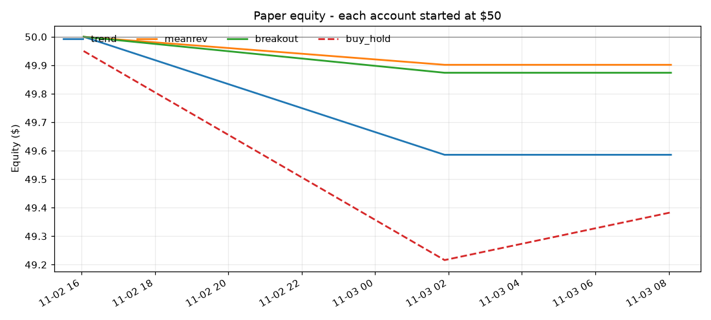

# Crypto paper-trading trial (🟢 RUNNING - 32.0h left)

Fake money, real binance_vision prices. Started **02 Nov 16:03 IST**, ends **04 Nov 16:03 IST**. Each strategy started with **$50**. Coins: BTC, ETH, SOL, XRP, DOGE on 15m candles. Fees 0.1%/side + 0.05% slippage included. Last update 03 Nov 08:03 IST (run #3).

| Account | Equity | P&L | Return | Trades | Win rate | Open |
|---|---:|---:|---:|---:|---:|---:|
| **trend** | $49.59 | $-0.41 | -0.83% | 3 | 0% | 0 |
| **meanrev** | $49.90 | $-0.10 | -0.20% | 1 | 0% | 0 |
| **breakout** | $49.87 | $-0.13 | -0.25% | 1 | 0% | 0 |
| *buy & hold (benchmark)* | $49.38 | $-0.62 | -1.23% | - | - | - |

## Strategies

- **trend**: Trend - EMA 9/21 crossover above EMA 200. SL 2xATR, TP 4xATR, exits on cross-down
- **meanrev**: Mean reversion - RSI(14) bounces back over 35 in an uptrend. SL 1.5xATR, TP 2xATR, 6h time stop
- **breakout**: Breakout - close above 20-candle high on 1.5x volume. SL 1.5xATR, trailing stop 2xATR

## Open positions

None.

## Last 25 closed trades

| Strategy | Coin | In | Out | Entry | Exit | P&L | Why |
|---|---|---|---|---:|---:|---:|---|
| trend | XRP | 02 Nov 19:15 | 02 Nov 19:45 | 1.26163 | 1.25246 | $-0.154 (-0.93%) | stop-loss |
| breakout | XRP | 02 Nov 19:15 | 02 Nov 19:30 | 1.26163 | 1.25459 | $-0.126 (-0.76%) | stop-loss |
| trend | XRP | 02 Nov 18:00 | 02 Nov 18:45 | 1.25423 | 1.24957 | $-0.095 (-0.57%) | EMA cross-down |
| trend | ETH | 02 Nov 20:30 | 02 Nov 21:30 | 2292.94 | 2274.69 | $-0.166 (-0.99%) | stop-loss |
| meanrev | BTC | 02 Nov 19:15 | 02 Nov 19:30 | 78203.1 | 77898.2 | $-0.098 (-0.59%) | stop-loss |

_Two days is a tiny sample: treat this as a smoke test, not proof a strategy works._
